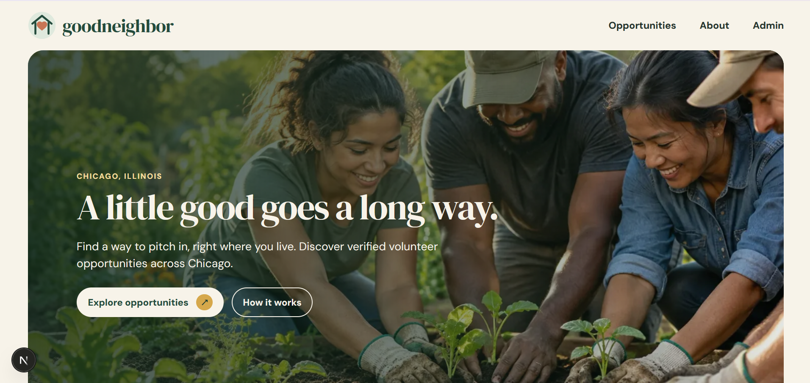

# GoodNeighbor

**A calm, trustworthy way to discover verified volunteer opportunities across Chicago.**

[Live application](https://goodneighbor-psi.vercel.app/) · [Browse opportunities](https://goodneighbor-psi.vercel.app/opportunities) · [Product documentation](docs/PRODUCT_SPEC.md)



GoodNeighbor is a Chicago-only volunteer opportunity guide. Visitors can search and filter verified listings, understand what each role involves, and continue directly to an organizer's official website. A protected single-admin dashboard supports the editorial workflow without introducing public accounts, registrations, or a full CMS.

## What GoodNeighbor does

### Public experience

- Presents a curated launch collection of eight verified Chicago opportunities.
- Supports search and filtering by cause, neighborhood, and timing.
- Provides accessible detail pages with Chicago-local date formatting.
- Displays the official source and the date each listing was last verified.
- Sends visitors to the organizer's external website to take action.
- Accepts text-only opportunity suggestions for private admin review.

### Admin experience

- Restricts access to one allowlisted GitHub identity through Auth.js.
- Creates, edits, publishes, unpublishes, and deletes opportunities through REST endpoints.
- Keeps drafts out of public pages and public API responses.
- Manages active and archived visitor listing requests.
- Surfaces six-month source-review cues for published listings.
- Validates every write on the server and returns structured API errors.

## Product principles

- **Local by design:** v1 is intentionally limited to Chicago.
- **Verified before published:** every public record includes an official source and verification date.
- **Direct connection:** GoodNeighbor does not collect volunteer registrations; organizers own participation and logistics.
- **Small administrative surface:** one allowlisted administrator manages editorial content.
- **Accessible by default:** semantic structure, keyboard support, visible focus, reduced motion, and responsive layouts are treated as core behavior.

## Technology

| Layer | Implementation |
|---|---|
| Application | Next.js App Router, React, TypeScript |
| Styling | Tailwind CSS and project design tokens |
| Database | Neon PostgreSQL |
| Data access | Prisma ORM with committed migrations and the Neon adapter |
| Authentication | Auth.js with GitHub OAuth and a server-side admin allowlist |
| API | Custom same-origin REST route handlers using `fetch` |
| Validation | Zod |
| Testing | Vitest, Testing Library, and manual browser/accessibility checks |
| Hosting | Vercel |

Public listing pages are server-rendered. Client components are reserved for focused interactions such as search, filters, slideshow controls, dialogs, and admin forms.

## Architecture at a glance

```text
Browser
  ├─ Public Server Components ── Prisma ── Neon PostgreSQL
  ├─ Interactive React UI ────── REST API ── Prisma ── Neon PostgreSQL
  └─ Admin dashboard ─────────── Auth.js/GitHub OAuth
                                   └─ server-side GitHub ID allowlist
```

The database is the live source of truth. Admin changes update Neon directly; they do not rewrite `prisma/seed.ts` or create Git commits.

## Opportunity photos

The admin can add a photo while **creating or editing an opportunity**. Both forms accept JPEG, PNG, or WebP images under 3 MB and require a description for screen readers when a photo is selected. Published listing cards and detail pages then display the photo. Until Blob is connected, leave the optional photo field empty and save the listing normally.

Photos are uploaded to a **private Vercel Blob store**; Neon stores only the URL in `Opportunity.imageUrl` and the description in `Opportunity.imageAlt`. No database migration is needed to enable photo uploads.

To enable uploads on Vercel, create a **Private** Blob store from the GoodNeighbor project's **Storage** page and connect it to the **Production** environment. The connection supplies either `BLOB_READ_WRITE_TOKEN` or Vercel's OIDC store configuration. Redeploy after connecting the store so the running app receives the new configuration. For localhost testing, add the store's `BLOB_READ_WRITE_TOKEN` to the ignored `.env.local` and restart the dev server. Never put that token in browser code or commit it. See [Vercel's private Blob setup](https://vercel.com/docs/vercel-blob/private-storage).

## Local development

### Prerequisites

- Node.js 20.9 or newer
- npm
- A Neon PostgreSQL project or isolated Neon branch
- A GitHub OAuth application for local authentication

### Installation

```bash
git clone <repository-url>
cd goodneighbor
npm install
```

Copy `.env.example` to `.env.local` and provide local credentials:

```ini
DATABASE_URL=postgresql://...-pooler.../neondb?sslmode=require
DIRECT_URL=postgresql://.../neondb?sslmode=require
AUTH_GITHUB_ID=
AUTH_GITHUB_SECRET=
AUTH_SECRET=
ADMIN_GITHUB_ID=
ADMIN_GITHUB_LOGIN=
```

- `DATABASE_URL` must use Neon's pooled endpoint for application traffic.
- `DIRECT_URL` must use the direct endpoint for migrations.
- `ADMIN_GITHUB_ID` is preferred; `ADMIN_GITHUB_LOGIN` is an optional fallback.
- Keep `.env.local` private and out of version control.

Set the local GitHub callback URL to:

```text
http://localhost:3000/api/auth/callback/github
```

Apply committed migrations, optionally seed a new isolated database, and start the app:

```bash
npm run db:deploy
npm run db:seed
npm run db:verify-seed
npm run dev
```

Open [http://localhost:3000](http://localhost:3000).

> Run `db:seed` only when intentionally populating a new or disposable branch. Do not automatically reseed production; admin edits make the production database the continuing source of truth.

## Available commands

| Command | Purpose |
|---|---|
| `npm run dev` | Start the Next.js development server using `.env.local` |
| `npm run build` | Create an optimized production build |
| `npm run start` | Run the production build locally |
| `npm run lint` | Run ESLint |
| `npm run typecheck` | Check TypeScript without emitting files |
| `npm test` | Run the automated test suite |
| `npm run db:generate` | Regenerate Prisma Client |
| `npm run db:migrate` | Create/apply migrations in development |
| `npm run db:deploy` | Apply committed migrations to the configured database |
| `npm run db:seed` | Populate the intentional target with the eight launch records |
| `npm run db:verify-seed` | Verify the launch-record count and required source metadata |

## Database workflow

GoodNeighbor uses committed Prisma migrations rather than `prisma db push`.

1. Create or modify schema changes on an isolated Neon branch.
2. Generate and review the migration locally.
3. Run lint, type checking, tests, build, and migration verification.
4. Exercise public and admin flows against the isolated branch.
5. Apply reviewed migrations deliberately to production with `npm run db:deploy` using the direct connection.

Never point a preview deployment at production for migration testing. Runtime traffic should use the pooled URL; migration commands should use the direct URL.

## Testing and verification

Before release or handoff, run:

```bash
npm run lint
npm run typecheck
npm test
npm run build
npx prisma migrate status
npm run db:verify-seed
```

The manual release gate also covers:

- Anonymous discovery through the external organizer action.
- Authenticated, unauthenticated, and non-allowlisted admin boundaries.
- Complete draft, publish, edit, unpublish, and delete workflows.
- Visitor suggestion and admin inbox workflows.
- Keyboard navigation, focus visibility, reduced motion, and 200% zoom.
- Desktop and narrow mobile layouts.
- Current official-source verification for all launch listings.

See [docs/TEST_PLAN.md](docs/TEST_PLAN.md) and [docs/RELEASE_CHECKLIST.md](docs/RELEASE_CHECKLIST.md) for the full gate.

## Production deployment

The application is deployed on Vercel at [goodneighbor-psi.vercel.app](https://goodneighbor-psi.vercel.app/).

Configure these variables in the Vercel **Production** environment:

```text
DATABASE_URL
DIRECT_URL
AUTH_GITHUB_ID
AUTH_GITHUB_SECRET
AUTH_SECRET
ADMIN_GITHUB_ID
ADMIN_GITHUB_LOGIN   # optional fallback
```

The production GitHub callback is:

```text
https://goodneighbor-psi.vercel.app/api/auth/callback/github
```

Vercel must connect to the intended Neon production branch—not a separately provisioned Prisma Postgres database. Environment-variable changes require a new deployment before they affect the live application.

## Content stewardship

Verification is an ongoing editorial responsibility. The allowlisted administrator reviews the dashboard monthly and reverifies every published listing at least once every six months. A listing is unpublished when its official source is broken, its availability has ended, or its details cannot be substantiated.

The interface's verification date records the last genuine source check; it is never advanced merely to clear a reminder. See [docs/CONTENT_REVIEW.md](docs/CONTENT_REVIEW.md) for the operating procedure.

## v1 boundaries

GoodNeighbor intentionally does not include:

- Public user accounts or saved opportunities.
- Volunteer registration, scheduling, messaging, attendance, or payments.
- Self-publishing or multi-admin role management.
- Maps or geographic expansion beyond Chicago.
- A CMS or automated third-party listing ingestion.
- Claims of organizer partnership without substantiation.

## Project documentation

- [Product specification](docs/PRODUCT_SPEC.md)
- [Technical specification](docs/TECHNICAL_SPEC.md)
- [Design specification](docs/DESIGN_SPEC.md)
- [Build plan](docs/BUILD_PLAN.md)
- [Test plan](docs/TEST_PLAN.md)
- [Release checklist](docs/RELEASE_CHECKLIST.md)
- [Compatibility decisions](docs/COMPATIBILITY_DECISIONS.md)
- [Content review procedure](docs/CONTENT_REVIEW.md)
- [Prompt log](prompt-log.md)

## Author

Designed and built by **Kendra Anne Hartnett** — [@kendrahartnett](https://github.com/kendrahartnett)

Built in collaboration with Codex.
